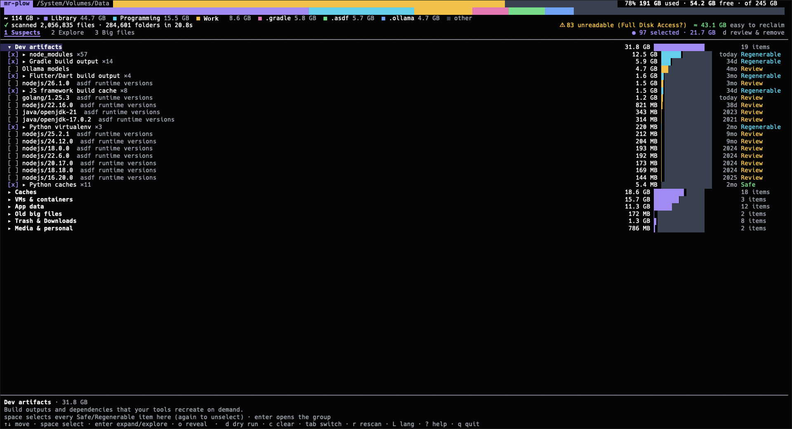

# mr-plow

*"Mr. Plow, that's my name. That name again is Mr. Plow."*

A terminal UI that shows what's eating your disk (caches, containers, 2013 `node_modules`, ten-year-old ISOs, your mom's music) and lets you remove it **after seeing the exact `rm` it will run**.



> **mr-plow deletes files. Use it at your own risk.** See the [disclaimer](#disclaimer).

- **One static binary**, about 4 MB per architecture, no runtime. macOS (universal) and Linux.
- **Fast:** parallel walker using macOS `getattrlistbulk(2)`, 3.7× faster than `du` on a full home folder. Known garbage locations are scanned first, and the last scan is shown instantly from cache. See [docs/02-SCANNER-PERF.md](docs/02-SCANNER-PERF.md).
- **Paranoid:**
  - no network code
  - never follows symlinks
  - never touches `/`, your home or its top folders, system paths or mount points
  - re-checks every path's inode right before deleting
  - never runs sudo itself
  - logs every action

  See [docs/03-SAFETY-MODEL.md](docs/03-SAFETY-MODEL.md).
- **English / Español.** Colours adapt to light and dark terminals.

## Install

Download a binary from [Releases](https://github.com/ivaneidel/mr-plow/releases) (macOS universal, Linux amd64/arm64), or:

```sh
# macOS (Apple Silicon + Intel)
curl -fsSL https://github.com/ivaneidel/mr-plow/releases/latest/download/mr-plow_darwin-universal.tar.gz | tar -xz mr-plow
# Linux (x86_64; use linux-arm64 for ARM)
curl -fsSL https://github.com/ivaneidel/mr-plow/releases/latest/download/mr-plow_linux-amd64.tar.gz | tar -xz mr-plow
# or, with Go installed
go install github.com/ivaneidel/mr-plow/cmd/mr-plow@latest
```

The macOS binary isn't signed. If a browser download refuses to open, run `xattr -d com.apple.quarantine mr-plow`.

## Use

```sh
mr-plow                  # scan your home
mr-plow --root ~/Code    # scan one folder
mr-plow --dry-run        # look around; Apply is disabled (or MR_PLOW_DRY_RUN=1)
mr-plow --report         # text report, no UI
mr-plow --bench          # scanner vs du
mr-plow --lang es
```

1. **Suspects** tab: everything grouped (Dev artifacts, Caches, VMs & containers, App data, Old big files, Trash & Downloads, Media & personal, System-wide), each with a size, age, explanation and safety label (Safe / Regenerable / Review / Personal).
2. `space` selects (on a group header it selects every Safe and Regenerable item), `enter` expands, `2` Explore (ncdu-style), `3` Big files.
3. `d` opens the **dry run**, which lists every action with its exact shell command. Keys there:
   - `t` sends an item to the Trash instead of deleting it
   - `x` drops an item
   - `e` exports the plan as a `.sh`
   - `a` applies, then `y` confirms
4. The report shows what was freed, the disk before and after, any failures, and the root-only leftovers saved as a script you run yourself with `sudo`.

`?` shows all keys.

## Build

```sh
make build      # bin/mr-plow
make test       # vet (macOS + Linux), no-network check, unit tests
make release    # dist/: darwin universal + linux amd64/arm64

# publishing a release: push a tag, GitHub Actions builds and uploads the binaries
git tag v0.2.0 && git push origin v0.2.0
make fixture && HOME=/tmp/mr-plow-fixture/home bin/mr-plow   # try it on a fake home full of junk
```

Needs Go 1.25+. The module asks for 1.26; Go fetches that toolchain automatically.

## Disclaimer

mr-plow is provided **"as is", without warranty of any kind**, express or implied. It deletes files and runs cleanup commands on your system. The authors, maintainers and contributors **are not responsible for any data loss, damage or other consequences** of using it, including files removed by mistake, misidentified "safe" items, or bugs in the software.

You are solely responsible for what you choose to remove. Always read the dry run before applying, start with `--dry-run`, and keep backups of anything you care about.

## License

[MIT](LICENSE). The license's warranty disclaimer applies in addition to the one above.

## Docs

[00 plan](docs/00-PLAN.md) · [01 architecture](docs/01-ARCHITECTURE.md) · [02 scanner perf](docs/02-SCANNER-PERF.md) · [03 safety model](docs/03-SAFETY-MODEL.md) · [04 catalog](docs/04-CATALOG.md) · [STATUS](docs/STATUS.md)
